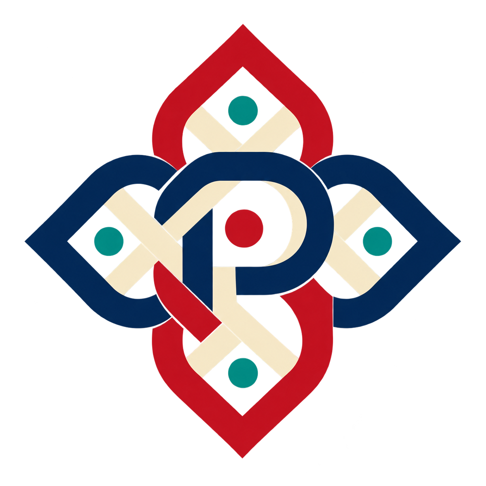

# Pramaan — Proof of Art

**Art you can prove.**

<p align="center"></p>

**Public demo:** [Pramaan on Hugging Face Spaces](https://huggingface.co/spaces/kshitijthakkar/pramaan-proof-of-art).

Pramaan is a generative-art benchmark inspired by Indian geometric craft traditions. Models propose structured PatternDSL designs; an independent deterministic checker evaluates declared rules on a fixed 64×64 raster, returns concrete counterexamples, and produces replayable certificates. The benchmark covers seven grammars, from Ajrakh-inspired repeat geometry to Sikku Kolam loops and Jaali lattices.

These designs are mathematical reinterpretations, not artisan-authentic work, ritual guidance, or physical printing guarantees. They do not replace craft practitioners. Ajrakh is practiced in Gujarat, Rajasthan, and Sindh in Pakistan. See [CITATIONS.md](CITATIONS.md) for cultural and technical references.

The project includes a Gradio Space, a sourced traditions registry covering 36 states and Union Territories, a 10-model leaderboard and comparison Arena, and an OpenEnv reinforcement-learning environment. Some examples draw on festival welcome patterns; the wider collection preserves the distinct traditions and communities represented by its sources.

## Run locally

```bash
# Windows PowerShell: py -3.12 -m venv .venv
# Activate: .venv\Scripts\Activate.ps1
# macOS/Linux: python3.12 -m venv .venv && source .venv/bin/activate
python -m pip install -r requirements-dev.txt
python app.py
```

The app opens with a checked example and works without model credentials. To enable local Beam generation, copy `.env.example` to `.env` and set `HF_TOKEN`. For the hosted Space, set it in **Settings → Secrets** with Inference Providers access. The token is used server-side; never put it in tracked files or browser inputs. Each worker permits one active generation, queues up to 32 app events, and defaults to a 40-request UTC-day cap including repairs and transient retries. Lower the cap with `PRAMAAN_DAILY_MODEL_CALL_CAP` in Space variables.

Prompts are sent to Hugging Face Inference Providers only when live generation is requested. Private runs are kept in the visitor's session; generated files use temporary worker storage, downloads expire after one hour, and the Gradio file cache is cleaned hourly. If the community contribution flow is enabled, publishing requires separate consent and replay checks. Those records are separate from the official training and benchmark datasets and are not added to them automatically. The built-in example works offline.

## Reproducible examples

The [examples directory](examples) contains design files, certificates, and saved trajectories for passing, repaired, and deliberately failing patterns. Gallery-only samples are illustrative; they are not benchmark results or training records. Run `python scripts/check_builtin_examples.py` to replay the bundled certificates and trajectories. To inspect the intentionally failing D4 design, run:

```bash
python -m pramaan.verify --design examples/ajrakh_d4_counterexample.pattern.json --certificate examples/ajrakh_d4_counterexample.certificate.json --json
```

Exit code `1` is expected for this fixture because D4 symmetry fails; `certificate_replay.matches` should be `true` when the saved failure report matches fresh replay.

## What is checked

The verifier checks strict PatternDSL v0.1/v0.2 input, a bounded 64×64 canvas, allowlisted geometry, and complexity limits. Depending on grammar, checks include reflection and rotational symmetry, dot clearance, stripe periods, grid quantization, Kolam mirror placement and exact loop counts, Jaali connectivity, hole margins, open fraction, palette, and layer registration. Certificates record canonical design and raster digests and can be recomputed from the saved design.

`EXACT_DISCRETE` means exhaustive checks of this finite raster model. Jaali minimum-web thickness uses a square morphological opening and is labeled `APPROXIMATE`. Raster periodicity does not prove continuous vector tangent or seam continuity. Certificates are unsigned: the verifier recomputes claims, but the JSON itself is not tamper-proof. Pixel checks do not establish print spacing, manufacturing behavior, structural suitability, or cultural authenticity.

The host, not the model, controls palette and constraint profile. Model output is parsed as data; model-authored code and HTML/SVG are never executed or rendered. Download bundles can include the image, PatternDSL, certificate, raw proposals, verifier feedback, full execution trajectory, token counts, timing, and cost evidence. Traces are not training-eligible until consented, reviewed, and replay-validated. Public runs are not silently added to a shared corpus.

## Model benchmark

The completed `eval-v2.1` comparison covers the same 72 task IDs for all ten models. Each run used the same deterministic verifier, a 4,096-token output ceiling, up to three proposals per task, zero provider retries, and the same input-size guard. Provider-specific request settings are recorded with the results; Anthropic, OpenAI-compatible, and Hugging Face endpoints do not expose identical sampling controls. The public evaluation export contains 720 model-task records, plus the leaderboard and certified reference data.

| Model | Tasks | Pass@1 | Pass@3 | Mean tokens / task | Mean request latency | Rate-card spend | Spend cap |
| --- | ---: | ---: | ---: | ---: | ---: | ---: | ---: |
| Beam | 72/72 | 23.6% | 65.3% | 7.9k | 7.8 s | $0.44 | — |
| Claude Fable 5.1 | 72/72 | 41.7% | 87.5% | 8.8k | 58.7 s | $20.63 | $22 |
| Claude Haiku 5.5 | 72/72 | 22.2% | 54.2% | 12.9k | 36.9 s | $0.34 | $10 |
| Claude Opus 5.5 | 72/72 | 8.3% | 90.3% | 9.3k | 36.6 s | $8.97 | $10 |
| Claude Sonnet 5.5 | 72/72 | 8.3% | 69.4% | 9.8k | 26.8 s | $4.49 | $10 |
| DeepSeek V4 Flash | 72/72 | 4.2% | 9.7% | 11.5k | 21.8 s | $0.45 | $10 |
| GPT-6 Astra | 72/72 | 81.9% | 93.1% | 3.3k | 20.7 s | $7.06 | $10 |
| GPT-6 Luna | 72/72 | 2.8% | 12.5% | 10.7k | 21.9 s | $0.16 | $10 |
| GPT-6.1 Sol | 72/72 | 79.2% | 91.7% | 3.5k | 20.2 s | $1.51 | $10 |
| GPT-6.1 Terra | 72/72 | 52.8% | 79.2% | 5.4k | 25.5 s | $0.96 | $10 |

Pass rates use all 72 frozen task IDs. Token and latency columns are per-task means from the recorded runs. Spend is an estimated rate-card ledger amount; provider invoices were unavailable. The table shows Fable's settled estimate ($20.63); its conservative exposure including pending reservations was $21.12 under the $22 cap. Each other paid arm used a $10 cap. These results are one observed run, not a confidence claim about future performance.

**Beam baseline:** 23.6% passed on the first proposal; repair accepted 30 of 55 initial failures (54.5%); 65.3% passed within three proposals. [See how 10 models compare in the Space](https://huggingface.co/spaces/kshitijthakkar/pramaan-proof-of-art#/leaderboard).

**Unsatisfiable task:** `py_kolam-as-practised-in-puducherry-easy-35` requests one loop on a 2×2 D2 Kolam grid. Exhaustive enumeration shows that this frozen profile permits either zero or two loops, never one. The prompt stays in the shared benchmark denominator for every model; it has no reference pattern and the paid results were not rerun. The reference dataset contains 71 verified designs for the other tasks.

Third-party model outputs are evaluation data only (`training_eligible=false`). They are not used to train the evaluated models. See the [benchmark protocol](docs/benchmark-protocol.md), [trajectory schema and reuse policy](benchmarks/TRAJECTORY_DATASET.md), and the [Hugging Face Evaluation Results documentation](https://huggingface.co/docs/hub/eval-results).

## Development

Install pinned development dependencies with `python -m pip install -r requirements-dev.txt`. Before implementation commits, run the local gates; they do not make Beam calls:

```bash
python -m pytest -q
python scripts/run_local_checks.py
```

The checks use integer-grid raster masks and pinned Pillow drawing conventions; results are not proofs about continuous or manufactured objects.

## Published resources

- [Live Space](https://huggingface.co/spaces/kshitijthakkar/pramaan-proof-of-art) for the interactive studio and model comparison.
- [GitHub repository](https://github.com/Mandark-droid/Proof-of-Art) with the verifier, evaluation protocol, and client code.
- [Pramaan Collection](https://huggingface.co/collections/kshitijthakkar/pramaan-proof-of-art) with the Space and public datasets.
- [Evaluation dataset](https://huggingface.co/datasets/kshitijthakkar/pramaan-proof-of-art-eval-v2.1) with model results, replayable trajectories, leaderboard rows, and references.
- [Training dataset](https://huggingface.co/datasets/kshitijthakkar/pramaan-proof-of-art-train-v1) with SFT, repair, preference, and trajectory exports. This is the published `train-v1` snapshot; the corrected `train-v1.2` briefs have not yet been evaluated or exported as training records.
- [OpenEnv dataset](https://huggingface.co/datasets/kshitijthakkar/pramaan-proof-of-art-openenv) with separate training and evaluation transition splits.

The Space, source repository, benchmark results, training export, and RL transitions are published as distinct artifacts. The published training snapshot does not grow automatically when someone runs a model; private run traces remain private unless a visitor separately opts into the community contribution flow.
## RL environment

The same Docker Space serves the Studio at [`/studio`](https://kshitijthakkar-pramaan-proof-of-art.hf.space/studio/) and the OpenEnv playground at [`/web`](https://kshitijthakkar-pramaan-proof-of-art.hf.space/web/). The environment uses no model credentials: each action is parsed and checked by the deterministic verifier, which returns a finite reward from 0 to 1 and a replayable certificate when the design passes. The reward measures declared geometric checks; it does not test whether the rendered design has visible ink.

```python
from pramaan_env import PramaanAction, PramaanEnv

with PramaanEnv(base_url="https://kshitijthakkar-pramaan-proof-of-art.hf.space").sync() as env:
    obs = env.reset(task_id="tn_kolam-easy-22").observation
    result = env.step(PramaanAction(pattern_json=my_policy(obs.prompt_messages)))
    print(result.reward, result.done)
```

## Datasets

The [eval-v2.1 dataset](https://huggingface.co/datasets/kshitijthakkar/pramaan-proof-of-art-eval-v2.1) contains the 72-task held-out suite across 36 states and Union Territories, with replay-verified results and accepted previews for ten models. Third-party benchmark records are evaluation-only and carry `training_eligible=false`.

The published [train-v1 dataset](https://huggingface.co/datasets/kshitijthakkar/pramaan-proof-of-art-train-v1) has four exports: 339 SFT rows, 195 repair rows, 50 preference rows, and 144 trajectories. It is a historical prompt-suite snapshot and is separate from `eval-v2.1`. The corrected `train-v1.2` suite contains 144 sanitized briefs, including the Garo D2 opposite-edge mirror wording, but has not been evaluated or exported as training records.

The [OpenEnv dataset](https://huggingface.co/datasets/kshitijthakkar/pramaan-proof-of-art-openenv) contains role-separated reset/step records, actions, verifier evidence, rewards, and termination metadata in separate training and evaluation splits. See [the trajectory schema and reuse policy](benchmarks/TRAJECTORY_DATASET.md) for roles, provenance, and split rules.

Browse the [public Pramaan — Proof of Art collection](https://huggingface.co/collections/kshitijthakkar/pramaan-proof-of-art) for the Space and published evaluation, training, and OpenEnv datasets.
