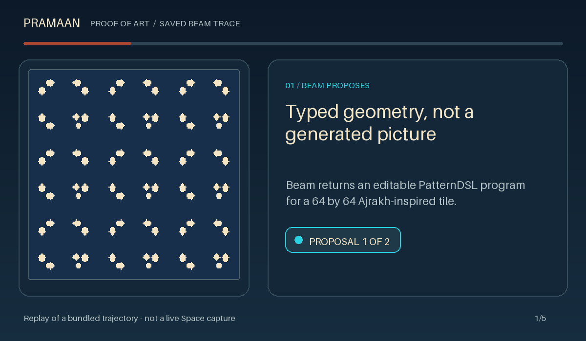
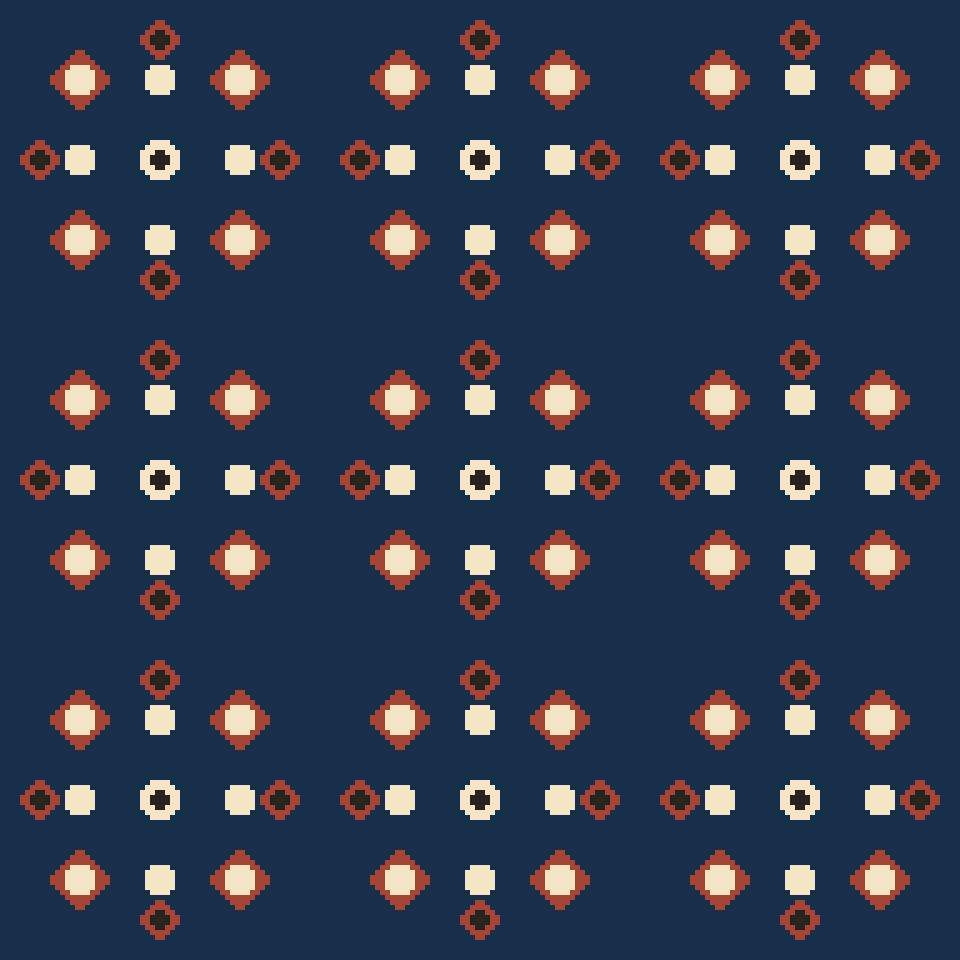
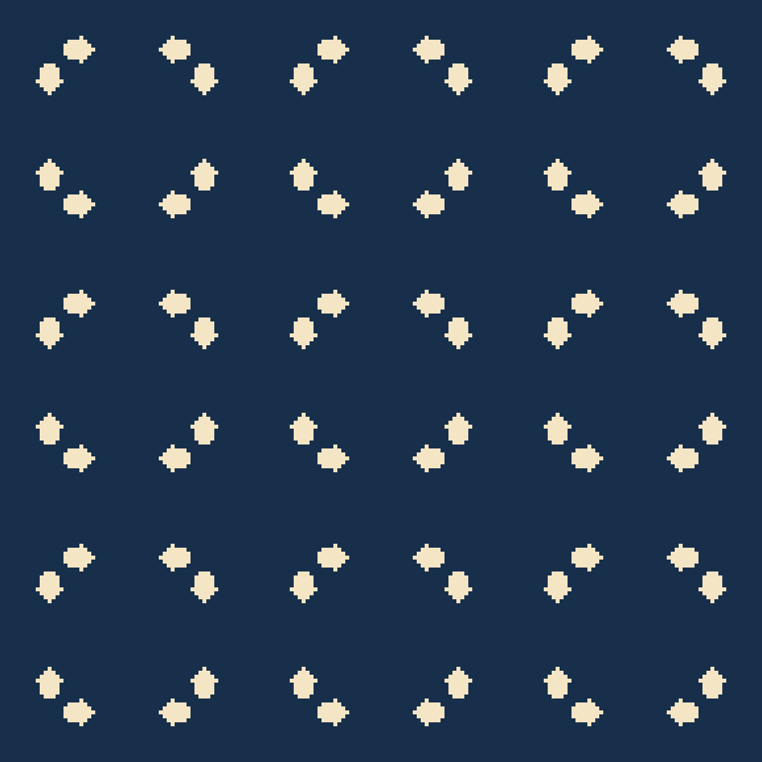
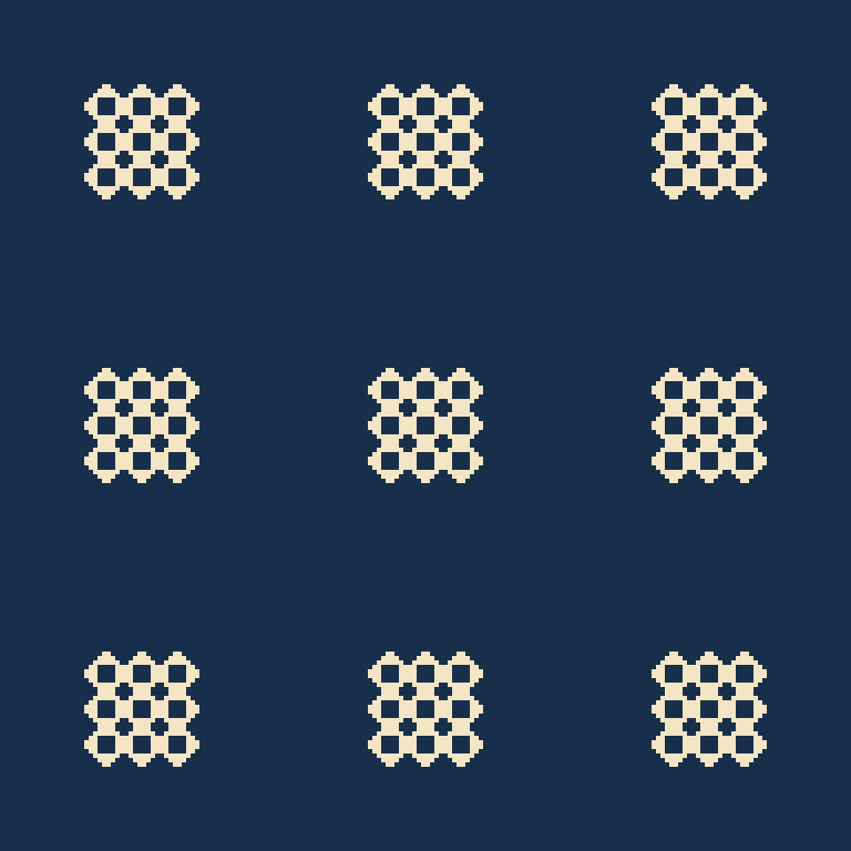

# Pramaan — Proof of Art

**Art you can prove.**

<p align="center"></p>

**Public demo:** [Pramaan on Hugging Face Spaces](https://huggingface.co/spaces/kshitijthakkar/pramaan-proof-of-art).

Pramaan is a generative-art demo and model benchmark inspired by Indian geometric craft traditions. A model proposes a structured PatternDSL design; an independent deterministic checker evaluates the requested rules on a fixed 64×64 raster, returns concrete counterexamples, and produces a replayable certificate. Verified examples span seven grammars, from Ajrakh-inspired repeat geometry to Sikku Kolam loops and Jaali lattices.

These designs are mathematical reinterpretations, not artisan-authentic work, ritual guidance, or physical printing guarantees. They do not replace craft practitioners. Ajrakh is practiced in Gujarat, Rajasthan, and Sindh in Pakistan. See [CITATIONS.md](CITATIONS.md) for cultural and technical references.

### A Diwali lens on geometric welcome

[Incredible India's Diwali overview](https://www.incredibleindia.gov.in/en/festivals-and-events/diwali) describes doorstep rangoli as welcome and festive decoration. Pramaan uses this as a festival lens while keeping its sourced registry of 36 entries across India's states and Union Territories distinct; this does not imply that every listed tradition is Diwali-specific. For broader context, see the [Indira Gandhi National Centre for the Arts' *Walls and Floors* resource](https://ignca.gov.in/walls-and-floors/).

The project pairs a Gradio studio with a sourced traditions registry, cross-state evaluation suites, and an OpenEnv reinforcement-learning environment. The responsive custom interface has six screens: Benchmark, Leaderboard, Gallery, Studio, Traditions, and RL. The Leaderboard supports model search, provenance filtering, metric sorting, shared-task ranking, and links to same-brief side-by-side Gallery reviews. On 30 October 2026, the public Space API reported running revision `8f31147`; read-only `/studio/` HTML contained the six screens, Leaderboard controls, Gallery state mosaic, and visitor model field. This confirms served markup, not responsive visual layout or browser first-contentful paint; clean-profile desktop/narrow review and cold-wake timing remain open.

## Run locally

```bash
# Windows PowerShell: py -3.12 -m venv .venv
# Activate: .venv\Scripts\Activate.ps1
# macOS/Linux: python3.12 -m venv .venv && source .venv/bin/activate
python -m pip install -r requirements-dev.txt
python app.py
```

The app opens with a checked example and works without model credentials. To enable local Beam generation, copy `.env.example` to `.env` and set `HF_TOKEN`. For the hosted Space, set it in **Settings → Secrets** with Inference Providers access. The token is used server-side; never put it in tracked files or browser inputs. Each worker permits one active generation, queues up to 32 app events, and defaults to a 40-request UTC-day cap including repairs and transient retries. Lower the cap with `PRAMAAN_DAILY_MODEL_CALL_CAP` in Space variables.

Prompts are sent to Hugging Face Inference Providers only when live generation is requested. Prompt and generated design files are not persisted beyond temporary worker files; downloads expire after one hour and the Gradio file cache is cleaned hourly. The built-in example works offline.

## Examples

### A recorded Beam repair

This animation replays a saved D4 trajectory: a symmetry failure, its coordinate witness, and the passing repair. It is reconstructed from the trajectory, not captured live from the Space.



The passing Ajrakh starfield below is hand-authored. The D4 rosette is a Beam-generated design repaired after the checker returned an exact symmetry counterexample. The deliberately failing counterexample and all generated examples have separate source files, certificates, and saved trajectories in [examples](examples). Gallery-only samples are not evaluation or training records.







Run `python scripts/check_builtin_examples.py` to replay the bundled certificates and trajectory fixtures. To inspect the intentionally failing D4 design, run:

```bash
python -m pramaan.verify --design examples/ajrakh_d4_counterexample.pattern.json --certificate examples/ajrakh_d4_counterexample.certificate.json --json
```

Exit code `1` is expected for this fixture because D4 symmetry fails; `certificate_replay.matches` should be `true` when the saved failure report matches fresh replay.

## What is checked

The verifier checks strict PatternDSL v0.1/v0.2 input, a bounded 64×64 canvas, allowlisted geometry, and complexity limits. Depending on grammar, checks include reflection and rotational symmetry, dot clearance, stripe periods, grid quantization, Kolam mirror placement and exact loop counts, Jaali connectivity, hole margins, open fraction, palette, and layer registration. Certificates record canonical design and raster digests and can be recomputed from the saved design.

`EXACT_DISCRETE` means exhaustive checks of this finite raster model. Jaali minimum-web thickness uses a square morphological opening and is labeled `APPROXIMATE`. Raster periodicity does not prove continuous vector tangent or seam continuity. Certificates are unsigned: the verifier recomputes claims, but the JSON itself is not tamper-proof. Pixel checks do not establish print spacing, manufacturing behavior, structural suitability, or cultural authenticity.

The host, not the model, controls palette and constraint profile. Model output is parsed as data; model-authored code and HTML/SVG are never executed or rendered. Download bundles can include the image, PatternDSL, certificate, raw proposals, verifier feedback, full execution trajectory, token counts, timing, and cost evidence. Traces are not training-eligible until consented, reviewed, and replay-validated. Public runs are not silently added to a shared corpus.

## Model benchmark

Pramaan evaluates models against versioned prompts and the same deterministic verifier. The audited `eval-v2.1` suite contains 72 tasks across 36 states and Union Territories. One Beam pass scored 17/72 pass@1 (23.6%) and 47/72 pass@3 (65.3%) over 146 candidate replays; 46 unique masks were accepted. All 72 rows passed independent replay. The rate-card estimate was USD 0.4382; provider-billed cost was unavailable. This single stochastic run is not a cross-model ranking.

The former `eval-v2` results and 144-task `train-v1` run are superseded. The sanitized 144-brief `train-v1.2` suite (canonical SHA-256 `c8bc4c59c6738b755bee24d8ed5af7fbe90bb9ca2a843dcd47c4e68bd9ad773e`) adds the explicit opposite-edge mirror instruction to the Garo D2 training brief; it has not been evaluated and has no matching trajectory or training export. See the [historical training dataset](https://huggingface.co/datasets/kshitijthakkar/pramaan-proof-of-art-train-v1), [evaluation data](https://huggingface.co/datasets/kshitijthakkar/pramaan-proof-of-art-eval-v2.1), and [trajectory schema and split policy](benchmarks/TRAJECTORY_DATASET.md).

A one-pass comparison of the Beam baseline and four paid models—Claude Haiku 5.5, Sonnet 5.5, Opus 5.5, and DeepSeek V4.1 Flash—is planned after release readiness and review of the exact task manifest and no-call cost preflight. Every paid model uses the same predeclared 47-task subset and 4,096-token output limit, with up to three proposals per task. Each paid model has its own USD 10 hard cap (USD 40 maximum total); an arm may stop at its cap, and quality comparisons use only task IDs completed by every compared model. The fixed protocol, provider differences, task-selection rule, and per-model cost gate are in [the benchmark protocol](docs/benchmark-protocol.md). No paid evaluation should begin before that preflight is reviewed.

The public Space offers visitor BYO-key evaluation as a 12-question Quick run by default. A 72-question run first shows a no-call estimate based on the official Beam run's mean token usage and the selected model's dated rate card, then requires separate confirmation; the Space enforces a USD 10 per-run cap and one capped run per account or browser session per UTC day, so a run can stop early. The daily guard is in memory and resets when the Space restarts. Private results stay in the visitor's session. Public dataset uploads require Hugging Face sign-in, separate opt-in, and replay checks. The public Hugging Face Collection currently links this Space, the current `eval-v2.1` and OpenEnv datasets, and the superseded `train-v1` and `eval-v2` datasets. The growing training/development trajectory dataset still needs to be produced from new runs. A Hub article covering verified results, costs, observations, and limitations remains planned. Hugging Face [Evaluation Results](https://huggingface.co/docs/hub/eval-results) is supplemental discovery; do not describe results as registered or Hub-verified without the required approval.

## Development

Install pinned development dependencies with `python -m pip install -r requirements-dev.txt`. Before implementation commits, run the local gates; they do not make Beam calls:

```bash
python -m pytest -q
python scripts/run_local_checks.py
```

The checks use integer-grid raster masks and pinned Pillow drawing conventions; results are not proofs about continuous or manufactured objects.

## Project status

The repository has verified Beam gallery examples for all seven grammars, a v0.2 grammar and verifier, and a replay-audited 72-task Beam baseline. The public Hugging Face Collection links the Space, current evaluation and OpenEnv datasets, and superseded public datasets. The one-pass multi-model run, growing run-derived training dataset, Hub article, clean Space deployment/history, browser review, and demo recording remain in progress. The public Space may not match `main`; check its deployed revision and user-facing screens before relying on source-only behavior.
## RL environment

The same Docker Space serves the Studio at [`/studio`](https://kshitijthakkar-pramaan-proof-of-art.hf.space/studio/) and the OpenEnv playground at [`/web`](https://kshitijthakkar-pramaan-proof-of-art.hf.space/web/). The environment uses no model credentials: each action is parsed and checked by the deterministic verifier, which returns a finite reward from 0 to 1 and a replayable certificate when the design passes.

```python
from pramaan_env import PramaanAction, PramaanEnv

with PramaanEnv(base_url="https://kshitijthakkar-pramaan-proof-of-art.hf.space").sync() as env:
    obs = env.reset(task_id="tn_kolam-easy-22").observation
    result = env.step(PramaanAction(pattern_json=my_policy(obs.prompt_messages)))
    print(result.reward, result.done)
```

## Datasets

The [eval-v2.1 dataset](https://huggingface.co/datasets/kshitijthakkar/pramaan-proof-of-art-eval-v2.1) contains 72 held-out tasks across 36 states and Union Territories, with replay-verified results and accepted previews. The [OpenEnv dataset](https://huggingface.co/datasets/kshitijthakkar/pramaan-proof-of-art-openenv) contains role-separated reset/step records, actions, verifier evidence, rewards, and termination metadata. The corrected `train-v1.2` suite has 144 sanitized briefs, including the Garo D2 opposite-edge mirror wording, but has not been evaluated and has no matching training trajectory or export; historical `train-v1` exports are superseded and must not be combined with current evaluation results. See [the trajectory schema and reuse policy](benchmarks/TRAJECTORY_DATASET.md) for roles, provenance, and split rules.

Browse the [public Pramaan — Proof of Art collection](https://huggingface.co/collections/kshitijthakkar/pramaan-proof-of-art) for the Space, current evaluation and OpenEnv datasets, and superseded public datasets.
