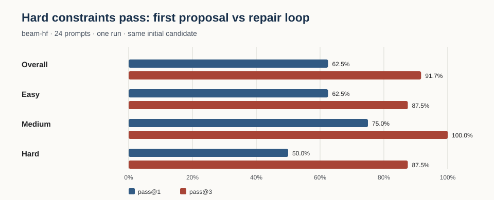

# Pramaan model benchmark

Pramaan benchmarks structured PatternDSL generation separately from the verifier. For each prompt and model, the first candidate provides the one-shot score; that exact candidate is then reused as the starting point for up to two verifier-guided repair turns. Scores are reported per model and are never pooled across models. The registry supports OpenAI-compatible chat completions and Anthropic Messages, keeps credentials in named environment variables, disables retries for capped runs, and disallows request settings that override model/messages or enable streaming.

## Current public data

[`data/beam-hf-shared-first-v2.jsonl`](data/beam-hf-shared-first-v2.jsonl) contains the first complete Beam run. Each prompt has one trajectory. The dataset keeps the structured candidates, check reports, usage metadata, and mask digests, and omits duplicate raw completion text. [`data/beam-hf-shared-first-v2-summary.json`](data/beam-hf-shared-first-v2-summary.json) and [`data/beam-hf-shared-first-v2-summary.csv`](data/beam-hf-shared-first-v2-summary.csv) contain the generated per-model and difficulty summaries.

[`data/beam-hf-trajectories-v1.jsonl`](data/beam-hf-trajectories-v1.jsonl) adds exact system/user request messages and raw model responses for every proposal and repair, linked to the parsed candidate, verifier report, and outcome. This 24-task release is tagged `benchmark_evaluation` and `training_eligible: false`; keep it held out when training or tuning models. It passes the standalone replay check: 24 task records and 38 replayed candidates. The schema, split policy, export and SFT-flattening commands are documented in [`TRAJECTORY_DATASET.md`](TRAJECTORY_DATASET.md). Future training data must use a distinct, predeclared prompt suite and split.

| Difficulty | Prompts | Schema valid @1 | Hard checks pass @1 | Pass after up to 2 repairs |
|---|---:|---:|---:|---:|
| Easy | 8 | 8/8 | 5/8 (62.5%) | 7/8 (87.5%) |
| Medium | 8 | 8/8 | 6/8 (75%) | 8/8 (100%) |
| Hard | 8 | 8/8 | 4/8 (50%) | 7/8 (87.5%) |
| **Overall** | **24** | **24/24 (100%)** | **15/24 (62.5%)** | **22/24 (91.7%)** |



Of the nine first candidates that failed a hard check, Beam-guided repair rescued seven (77.8%); two remained unresolved. The run recorded 38 candidate requests, zero provider errors, and 103,138 reported tokens. Mean end-to-end time was 4,215 ms per prompt and median provider-call latency was 2,616 ms. New runs retain per-call and total prompt/completion tokens, request and verifier latency, transient retry counts, provider-reported cost, and an optional separately labeled rate-card estimate. The provider did not return billed cost for this run; its trajectory file estimates **$0.0792 total** (about $0.0033 per prompt) using the Baseten rates observed that same date. This excludes HF credits, negotiated pricing, and any account-specific adjustments, so it is not the final account bill. Distinct accepted mask hashes are a novelty proxy only; they do not establish originality or aesthetic quality.

This is one run of one model and one provider configuration, not a repeated-run estimate or cross-model ranking. It does not measure visual quality or cultural authenticity. Hosted model/provider versions and stochastic generation can change results. Before comparing other models, keep the prompt-suite digest and validator version fixed, record each model's provider and decoding settings, and disclose endpoint or budget differences.

### Unresolved examples

- `easy-07` requested a centered diamond with four satellites under D4. Its initial and final candidates failed `symmetry_d4` after all three proposals.
- `hard-06` requested separated zones under D2 symmetry. Its initial and final candidates failed `symmetry_d2` after all three proposals.

The failure witnesses and all candidate geometry are retained in the public JSONL so both cases can be replayed; failure is not silently converted into a passing result.

- Prompt-suite SHA-256: `7b03ccb6309ca5a09a610077c427c8463a448481cf5d343f2a1959e255031e20`
- Benchmark version: `pramaan-paired-shared-first-v2`
- Validator version: `0.2.0`
- Model key: `beam-hf` (`reflection/Beam-1.0-501B-A23B:baseten` via Hugging Face Inference Providers)
- Request settings: temperature 0.4, max tokens 4096, reasoning effort minimal.

## Reproduce and audit

With `HF_TOKEN` configured, install the pinned dependencies and run:

```bash
python benchmarks/run.py --model beam-hf --output benchmarks/results/beam-hf-local.jsonl
python scripts/check_benchmark_results.py benchmarks/results/beam-hf-local.jsonl --model beam-hf --require-complete
python scripts/export_public_benchmark.py benchmarks/results/beam-hf-local.jsonl --model beam-hf --output benchmarks/data/my-beam-run.jsonl
python benchmarks/summarize.py benchmarks/data/my-beam-run.jsonl --model beam-hf
```

The CLI flushes after each prompt and refuses to overwrite. To continue an interrupted segmented run, use the same output path with `--resume`, `--start OFFSET`, and optionally `--limit COUNT`. Resume validates the locked prompt-suite digest, benchmark and validator versions, model identity, request settings, and duplicate pairs before appending. A full 24-prompt run can use up to 72 candidate requests plus transient retries. The app's default local daily cap is 40 requests; segment the run or explicitly adjust the cap only after checking available provider allowance. Raw local result files remain under the git-ignored `benchmarks/results/` directory. The compact public export omits duplicate raw completion text; the separate trajectory export retains full prompts and responses for reproducibility and is evaluation-only.

## Predeclared suites v2

`eval-v2.1.jsonl` is the current held-out evaluation suite with 72 prompts: one easy and one hard prompt for each of the 28 states and 8 union territories. It corrects two symmetry briefs and nine one-edge-border briefs from eval-v2; the older suite remains available for historical reproducibility and must not be mixed with v2.1 results. Hard prompts use a different-grammar alternate only when the registry marks that alternate high-confidence. `train-v1.2.jsonl` is the current sanitized training prompt split: 144 prompts, four per state, with no evaluation brief overlap or sacred-symbol terms. It explicitly mirrors the Garo Dakmanda wraparound-border motif onto the opposite edge for its D2 profile. Earlier train-v1 and train-v1.1 suites remain immutable historical prompt revisions; the builder refuses to overwrite a generated suite and each prompt revision receives a new suite ID. No training-v1.2 model outputs or training-eligible exports exist yet.

| Suite | Rows | SHA-256 |
|---|---:|---|
| `eval-v2.1` (current) | 72 | `b04b568d84d2568fd261789819d4e925844dba5afe9c5962275ee571d84e4e3a` |
| `eval-v2` (superseded; historical) | 72 | `a334e739accb928194c83c675e47f145d1607b9011efc4bc8b3099d44607f8f8` |
| `train-v1` (superseded) | 144 | `39e6f8cbf62db34e193c2800f8905bf7a621afbc1672fc9f2d46691c02ea70b6` |
| `train-v1.2` (current prompts; not yet evaluated) | 144 | c8bc4c59c6738b755bee24d8ed5af7fbe90bb9ca2a843dcd47c4e68bd9ad773e |

The suite builder validates constraint profiles with `ConstraintsV2` and caps every brief at the orchestrator’s 500-character limit. It refuses to overwrite the committed files; intentional suite changes require regenerating and recording the digest before a run.

### Historical Beam runs (29 Oct 2026; eval-v2 is superseded)

Both suites were rerun through `PramaanEnvironment` after the v0.2 prompt updates and the palette-bound correction. Candidate reports replayed against the verifier with complete, duplicate-free task coverage and no provider errors. Schema rate is first-proposal parse success; pass rates are all hard checks passing at proposal 1 or within three proposals. Each result is one stochastic Beam run, not a quality or cultural-authenticity estimate.

| Suite | Tasks | Schema @1 | Pass @1 | Pass @3 | Accepted | Estimated cost* |
|---|---:|---:|---:|---:|---:|---:|
| `eval-v2` | 72 | 76.4% | 23.6% | 56.9% | 41 | $0.4257 |
| `train-v1` (historical, superseded prompts) | 144 | 81.9% | 22.2% | 61.8% | 89 | $0.7339 |
| `train-v1.2` | not run | -- | -- | -- | -- | -- |

Historical eval-v2 per-grammar coverage (tasks / schema@1 / pass@1 / pass@3): counted_grid 31 / 71.0% / 29.0% / 74.2%; dot_field 4 / 100.0% / 0.0% / 75.0%; jaali_lattice 5 / 80.0% / 0.0% / 0.0%; kolam_loop 3 / 100.0% / 0.0% / 0.0%; periodic_raster 11 / 100.0% / 45.5% / 81.8%; rotational_field 4 / 75.0% / 50.0% / 75.0%; stripe_band 14 / 57.1% / 7.1% / 21.4%. The summaries and exact per-state and per-level values are in [`eval-v2-summary.json`](data/eval-v2-summary.json) and [`train-v1-summary.json`](data/train-v1-summary.json).

All 17 Jaali tasks now carry valid host-owned open-fraction bounds: the explicit hard brief uses [0.40, 0.50], while other tasks use the documented [0.25, 0.75] default. In this run, Jaali pass@3 was 0/5 on eval and 0/12 on train. Most failures were genuine geometry outcomes (`jaali_single_solid`, `jaali_open_fraction`, and `symmetry_d2`), not missing bounds; all 12 train first proposals parsed. Reward remains 0 for parse errors and 1 only for a fully passing design; partial rewards are episode shaping and are not benchmark pass scores.

*Provider-reported billed cost was unavailable. These are dated rate-card estimates from captured token usage, not invoices or account charges.

### Current corrected Beam baseline (eval-v2.1, 30 Oct 2026)

The current suite has 72 prompts across all 28 states and 8 union territories. Its corrected 72-task Beam run was replay-checked with 72 scored rows, 146 candidate replays, and no provider errors. Schema validity was 81.9%; hard-constraint pass@1 was 23.6% (17/72), and pass@3 was 65.3% (47/72). There were 46 unique accepted masks. The estimated cost was USD 0.4382; the provider did not report billed cost. This is one stochastic run and measures declared geometry only, not visual merit or cultural authenticity.

Artifacts: [`eval-v2.1.jsonl`](suites/eval-v2.1.jsonl), [`eval-v2.1-trajectories.jsonl`](data/eval-v2.1-trajectories.jsonl), [`eval-v2.1-compact.jsonl`](data/eval-v2.1-compact.jsonl), [`eval-v2.1-summary.json`](data/eval-v2.1-summary.json), [`eval-v2.1-summary.csv`](data/eval-v2.1-summary.csv), [`eval-v2.1-summary.svg`](data/eval-v2.1-summary.svg), 47 accepted-design previews in [`eval-v2.1-previews/`](data/eval-v2.1-previews/), and the 72-episode, 235-transition [`OpenEnv shard`](data/openenv-eval-v2.1-beam-20261030.jsonl). The prompt-suite SHA-256 is `b04b568d84d2568fd261789819d4e925844dba5afe9c5962275ee571d84e4e3a`.

### India quilt gallery data

`scripts/build_gallery_data.py` writes `assets/gallery/index.json` and one lazy `assets/gallery/<model_key>.json` payload per model. The index records the frozen suite/verifier identity, all 36 state and Union Territory placements, Wilson 95% intervals, per-model coverage, common completed prompt IDs, and verifier-scored no-model baselines. Every per-model payload has an entry for all 72 suite tasks; tasks not reached before a spend cap are marked `not_run`, while completed task attempts contain replay-verified checker failures, witnesses, certificate and mask digests, and indexed PNG previews. The builder rejects suite/task mismatches and candidate/check disagreements and keeps each model payload below 400 KB.

Rebuild the published Beam payload from the audited trajectory export:

```bash
uv run --project . python scripts/build_gallery_data.py \
  --suite benchmarks/suites/eval-v2.1.jsonl \
  --trajectory benchmarks/data/eval-v2.1-trajectories.jsonl \
  --output assets/gallery
```

Repeat `--trajectory` for each additional official model after its capped run is audited. Visitor runs remain separate; only sanitized, explicitly published, replay-verified community rows may appear in a community view.


### Capped multi-model evaluation

The paid-provider runner defaults to `beam-hf`; selecting additional models always requires explicit `--model` arguments. Budgeted runs use the frozen `eval-v2.1` question order and at most three proposals per question. Every provider has a 4,096-token output ceiling. Beam and DeepSeek use temperature 0.4; Anthropic rejects temperature on these models, so Claude runs omit it and set `output_config.effort=low`. Record this sampling difference with every comparison. `--preflight-only` reports each model's conservative full-suite cost, per-model cap, and estimated complete-question coverage. Each model proceeds through questions in the same order and starts a question only while its remaining cap can reserve all three maximum-size requests; when that is no longer possible, the runner records all completed rows and proceeds to the next model. One UTF-8 byte is reserved as one input token, plus 256 per-request framing tokens; cache discounts are ignored. Each outbound request reserves its full input/output upper bound in `benchmarks/results/provider-spend-ledger.jsonl`, makes one provider attempt, and reconciles reported USD cost or a rate-card estimate. If usage is missing, its full reservation stays charged. Completed model/question rows are flushed immediately; resume keeps the same suite, model settings, rate card, per-model cap and fills only missing pairs.

The selected comparison contains Haiku 5.5, Sonnet 5.5, Opus 5.5 and Fable 5.1 through Anthropic, plus DeepSeek V4.1 Flash through CometAPI. Each model has its own hard USD 10 cap; the aggregate ceiling is USD 50. The one-pass protocol uses the same ordered 47-task `eval-v2.1-common47` suite, 4,096 output-token limit and maximum of three proposals per question for every arm. A no-call preflight imported prior-scope ledgers and found commitments of USD 0.016837 (Haiku), 0.805374 (Sonnet), 1.650368 (Opus, including an orphan reservation), 0 (Fable), and 0.01374264 (DeepSeek). Under conservative maximum request reservations, the remaining caps support at most 47, 41, 18, 9 and 47 additional complete questions, respectively. These ceilings are not promised coverage: every arm stops before starting a question unless all three maximum request reservations fit under its remaining individual cap. Refresh this exact preflight and have the user review it before dispatch; the earlier paid-run decision is HOLD. Provider-reported billed cost is unavailable, and the CometAPI public card is not an account invoice. Report per-arm coverage and quality, then compare models only on shared completed task IDs. The ledger uses dated reference rates and cannot guarantee taxes, credits, negotiated rates, or upstream price changes.

**DeepSeek protocol note (official docs read 30 Oct 2026):** DeepSeek's Chat Completions API documents `deepseek-flash` and `deepseek-v4-pro`, a 384K maximum output, and reasoning controls. Thinking is enabled by default; temperature is documented but has no effect in thinking mode. The current first-party `deepseek-flash` price table lists cache-miss input at USD 0.15/M off-peak and USD 0.30/M peak, output at USD 0.60/M off-peak and USD 1.20/M peak, and cache-hit input at USD 0.003/M off-peak and USD 0.006/M peak. These first-party prices are reference only and do not price our CometAPI requests. The CometAPI model page currently lists USD 0.12/M input and USD 0.48/M output, with a 2× multiplier in two weekday peak windows; the benchmark ledger uses USD 0.24/M input and USD 0.96/M output as the conservative peak rates, while the account-specific active rate remains unconfirmed. The CometAPI arm therefore sends `extra_body.thinking.type="disabled"` with temperature 0.4 and the shared 4,096 output ceiling, so that its sampling setting is active. This benchmark calls CometAPI's `deepseek-v4.1-flash` alias, not DeepSeek's first-party endpoint; show the route, returned model alias, and dated cost estimate with the result. Sources: [DeepSeek Chat Completions API](https://api-docs.deepseek.com/api/create-chat-completion/), [Thinking Mode](https://api-docs.deepseek.com/guides/thinking_mode/), [DeepSeek Models and Pricing](https://api-docs.deepseek.com/quick_start/pricing/), [CometAPI DeepSeek V4.1 Flash model page](https://www.cometapi.com/models/deepseek/deepseek-v4-1-flash/).

`benchmarks.summarize.summarize()` reports per-model coverage under `by_model` and adds `common_completed`, whose `prompt_ids` are the intersection of completed IDs across active models and whose per-model metrics are computed only on that intersection. Use that aligned subset for leaderboard ranking; keep full per-model coverage and scores visible beside it.

Run the offline preflight without credentials or provider calls:

```bash
uv run --project . python benchmarks/run.py --suite benchmarks/suites/eval-v2.1.jsonl \
  --model claude-haiku-5-5 --model claude-sonnet-5-5 --model claude-opus-5-5 \
  --model deepseek-v4.1-flash --preflight-only
```

The one-run and resume policy, provider pricing sources, and Hugging Face result compatibility are recorded below. No provider requests are made by `--preflight-only`.

### India quilt gallery data

`scripts/build_gallery_data.py` writes `assets/gallery/index.json` and one lazy `assets/gallery/<model_key>.json` payload per model. The index records the frozen suite/verifier identity, all 36 state and Union Territory placements, Wilson 95% intervals, per-model coverage, common completed prompt IDs, and verifier-scored no-model baselines. Every per-model payload has an entry for all 72 suite tasks; tasks not reached before a spend cap are marked `not_run`, while completed task attempts contain replay-verified checker failures, witnesses, certificate and mask digests, and indexed PNG previews. The builder rejects suite/task mismatches and candidate/check disagreements and keeps each model payload below 400 KB.

Rebuild the published Beam payload from the audited trajectory export:

```bash
uv run --project . python scripts/build_gallery_data.py \
  --suite benchmarks/suites/eval-v2.1.jsonl \
  --trajectory benchmarks/data/eval-v2.1-trajectories.jsonl \
  --output assets/gallery
```

Repeat `--trajectory` for each additional official model after its capped run is audited. Visitor runs remain separate; only sanitized, explicitly published, replay-verified community rows may appear in a community view.

### Hugging Face Evaluation Results compatibility

The Hub evaluation-results feature is a work in progress. A benchmark dataset needs a root `eval.yaml`, a framework identifier in Hugging Face's maintained enumeration, and beta allow-list approval before it is represented as a leaderboard. The current framework list does not contain `pramaan`, so do not push an `eval.yaml` naming it yet. Reusing `inspect-ai` would misstate this run: the current provider runner and deterministic PatternDSL verifier are not an Inspect AI evaluation.

Hub lookups found no model repositories for `anthropic/claude-haiku-5-5`, `anthropic/claude-sonnet-5-5`, or `anthropic/claude-opus-5-5`. The repository `deepseek-ai/DeepSeek-V4.1-Flash` exists, but the selected inference route is CometAPI; a score PR there must identify the route and be marked community-provided. No public model-score PR has been prepared or submitted.

When registration is feasible, use an `eval.yaml` with `evaluation_framework: pramaan`, task id `proof_of_art_eval_v2_1`, config `compact`, and split `test` on the current eval-v2.1 dataset. First add `pramaan` to the maintained Hub framework list, then push and validate `eval.yaml`, then request benchmark allow-list approval. Only call the dataset a registered leaderboard after Hub confirmation.

After the final one-pass evaluation is audited and the dataset revision frozen, prepare a local `.eval_results/*.yaml` draft for each existing target model repository. Use **pass@1 (%)** as the single leaderboard value; keep pass@3, schema rate, per-grammar results, cost, token counts, and latency in the Pramaan result/trajectory datasets. Preserve the run date, exact dataset revision, trajectory source link, provider route, resolved model alias, `max_tokens=4096`, three-proposal cap, suite SHA-256, validator version, dated cost source, and single-run caveat in `notes`. Do not include `verifyToken`: a local verifier replay is not an HF Jobs + Inspect verification token. Public PRs require separate user review and authorization.

The planned score-entry shape is:

```yaml
- dataset:
    id: kshitijthakkar/pramaan-proof-of-art-eval-v2.1
    task_id: proof_of_art_eval_v2_1
    revision: <frozen-dataset-commit>
  value: <pass-at-1-percent>
  date: "<run-date>"
  source:
    url: https://huggingface.co/datasets/kshitijthakkar/pramaan-proof-of-art-eval-v2.1
    name: Pramaan evaluation trajectories
    user: kshitijthakkar
  notes: "pass@1 (%); pass@3=<value>; provider=<route>; max_tokens=4096; max_attempts=3; suite_sha256=<digest>; validator=<version>; one stochastic run; deterministic verifier replay; cost provenance is in the source dataset."
```

## Contribute a local evaluation

Run the selected provider from your own machine so the provider key never passes through the Space:

```bash
uv run --project . python benchmarks/run.py --suite benchmarks/suites/eval-v2.1.jsonl \
  --model claude-haiku-5-5 --limit 12 --output benchmarks/results/my-run.jsonl
uv run --project . python scripts/pack_submission.py \
  benchmarks/results/my-run.jsonl benchmarks/results/my-run.zip
```

Use the model's provider key only through its documented environment variable for the local run. The packer makes a new ZIP containing `results.jsonl` and a SHA-256 manifest; it refuses suite/task mismatches, duplicate task IDs, credential-bearing fields, and overwriting an existing archive. Upload the ZIP through the Space's Contribute flow when available. The server validates the manifest and replays every candidate before publishing sanitized rows to the separate `kshitijthakkar/pramaan-community-runs` dataset. Community model identities are self-reported and unverified; rows are always `training_eligible: false`.

The Space publisher requires a fine-grained `HF_COMMUNITY_WRITE_TOKEN` scoped only to that community dataset. The read-only benchmark `HF_TOKEN` is not used for community writes. Public uploads are append-only, and the Space's ephemeral buffer may lose pending rows on restart.
